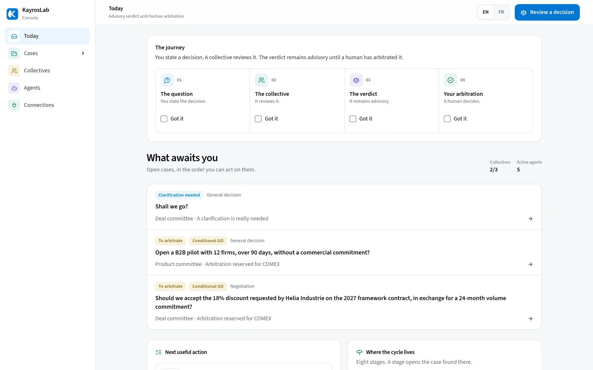
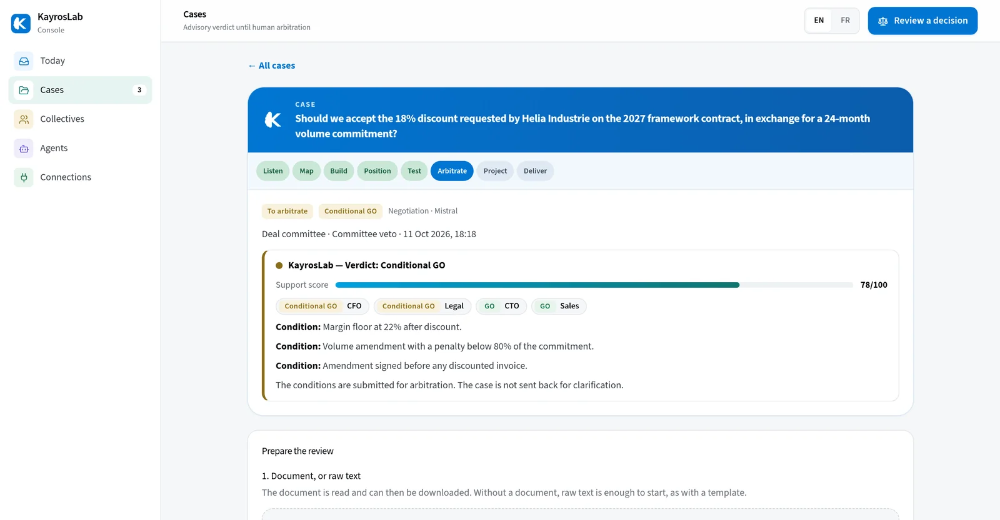
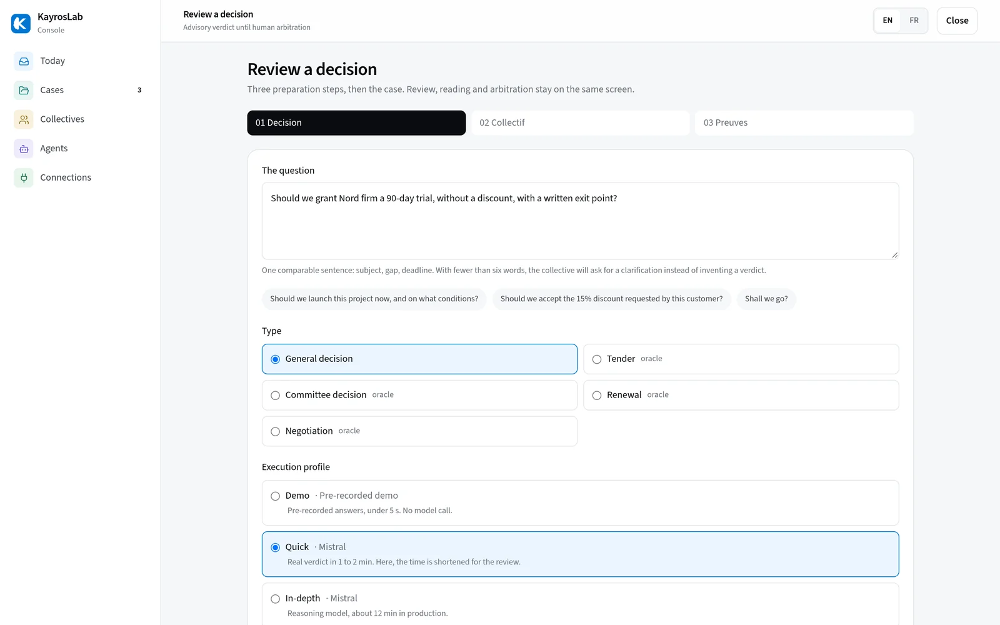
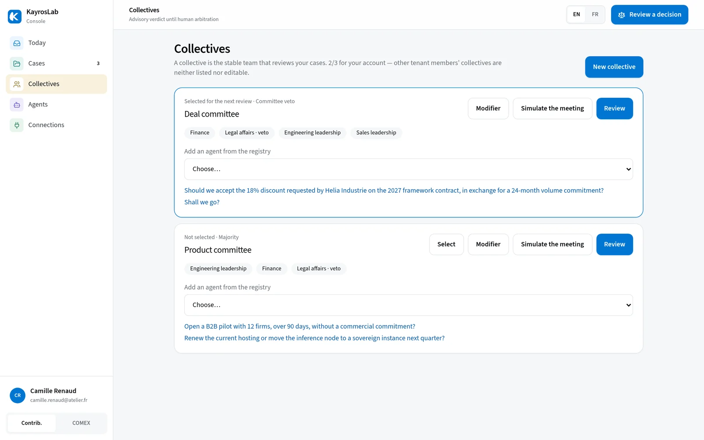
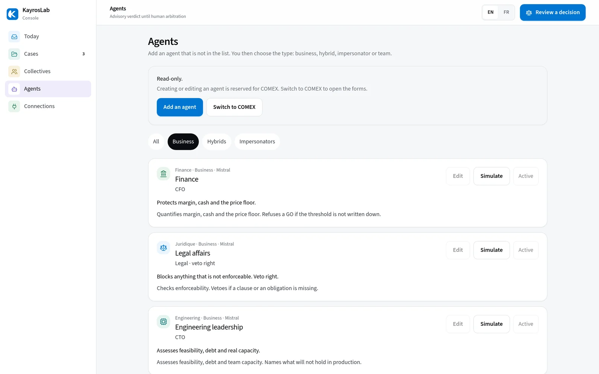
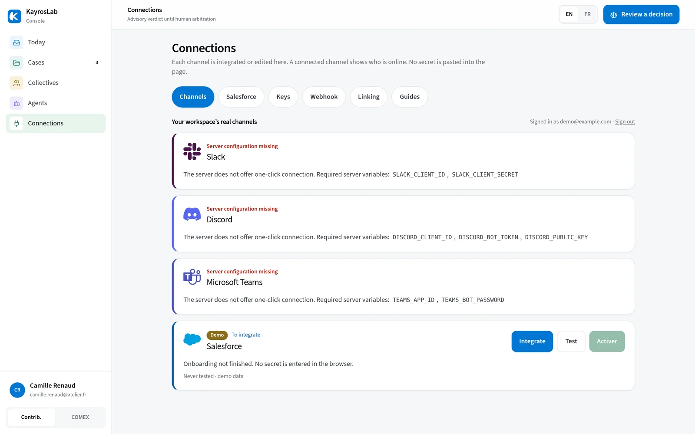
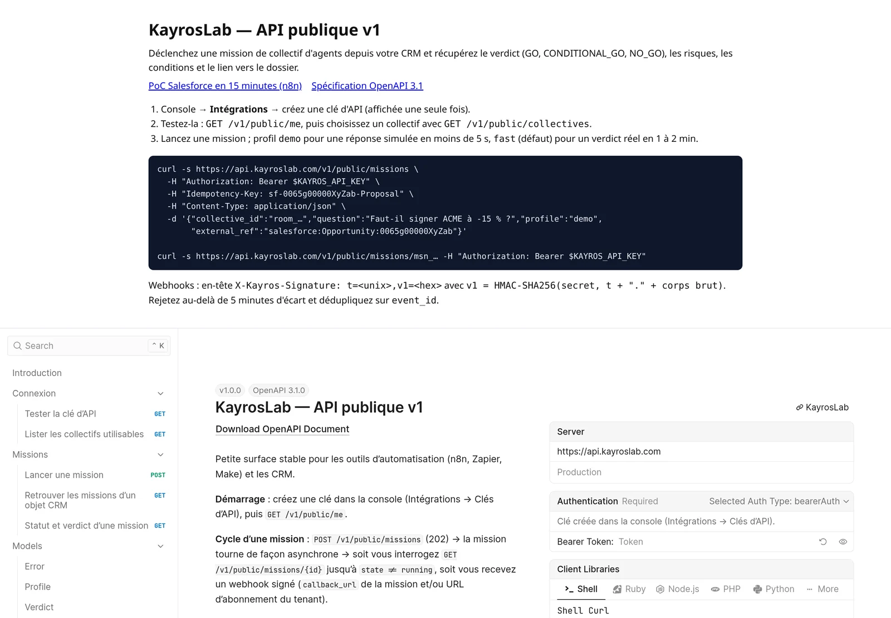

# KayrosLab

**The governed decision workshop that turns one strategic question into a board-ready verdict.**

You state the decision. A committee of specialized agents with opposing duties investigates the evidence, challenges assumptions, and consolidates objections into a clear verdict — **GO, conditional GO, or NO-GO**. The verdict stays consultative until a human arbitrates. Every claim, source, condition and vote stays in a durable, inspectable dossier.

[Try the console](https://www.kayroslab.com/console/) · [Website](https://www.kayroslab.com) · [API docs](https://api.kayroslab.com/docs) · [Contact](mailto:contact@kayroslab.com)

  

<em>The live console, Today view: the journey from question to arbitration, then the open cases in the order you can act on them. Verdicts stay advisory until a human arbitrates.</em>

---

## Why KayrosLab exists

Most strategic decisions are made in a meeting where the strongest voice wins and the numbers are adjusted afterwards. Nobody can reconstruct why the decision was taken — until it is too late.

KayrosLab changes the sequence:

1. **You pose one real decision.**
2. **A collective of agents with opposing duties** (finance, legal, engineering, sales…) investigates the evidence and attacks each other's assumptions.
3. **They return a structured verdict** with objections, conditions and a recommendation.
4. **A human arbitrates** — accepts, attaches conditions, or overrides a veto. Everything is recorded.

The result is not a chatbot answer. It is a **governed dossier** you can reopen, audit and defend.

---

## How it works — the 4-step journey

| Step | What happens | What you get |
|------|--------------|--------------|
| **1. The question** | You state the decision in plain language. | A clear mission scoped to one outcome. |
| **2. The collective** | Specialized agents investigate from their duty, not from a single agreeable model. | Objections, ranges, conditions and a consolidated verdict. |
| **3. The verdict** | GO, conditional GO or NO-GO — always consultative. | An inspectable dossier with sources and justifications. |
| **4. Your arbitration** | You accept, condition or override. A veto can block. | An append-only trail ready for the board or the next steering. |

The same process runs from the web console, Slack, Microsoft Teams or Discord.

---

## What the live console shows today

On [kayroslab.com/console](https://www.kayroslab.com/console/) (English and French, switch with EN / FR):

- **Today** — the journey, then open cases ordered by the action you can take next.
- **Cases** — full decision threads with status (Under review, To arbitrate, Clarification needed, Closed), the verdict, each agent's position and the trail.
- **Collectives & Agents** — compose committees of business, hybrid or impersonator agents, with veto rights.
- **Connections** — Slack, Teams, Discord, Salesforce, API keys, webhook and account linking.
- **8-step cycle** — Listen → Map → Build → Position → Test → Arbitrate → Project → Deliver.

  

<em>A case at the Arbitrate stage: consolidated verdict, support score, each agent's vote and the conditions a human must accept or override.</em>

| | |
|---|---|
|  **Review a decision** — the question, its type and the execution profile. |  **Collectives** — stable committees, voting rule and veto. |
|  **Agents** — each agent has a duty and a refusal rule. |  **Connections** — channels, Salesforce, keys and webhook. |

Every sensitive step can pause for a human. Forecasts are labelled simulations. Secrets stay encrypted. You choose local or cloud per workspace.

---

## The innovation

KayrosLab is the missing layer between conversation and action.

| Approach | What it gives | What is missing |
|----------|---------------|-----------------|
| Chat assistants | Fast answers | No role boundaries, no evidence discipline, no gates, no durable dossier |
| Innovation suites | Idea collection at scale | Weak multi-agent deliberation and human arbitration |
| DIY agent stacks | Orchestration | No memory, console, audit trail or veto by default |

KayrosLab ships the full decision workshop: opposing duties, inspectable reasoning, human gates with veto, and a dossier that survives the meeting.

---

## Trust & control

- **Human gates & veto** — sensitive output pauses for a human. Weighted votes instruct; a veto can block. Append-only trail.
- **Honest numbers** — forecast bands are labelled simulations from stated hypotheses.
- **Tenant isolation** — workspaces, dossiers and memories stay scoped to your organization. Secrets encrypted at rest.
- **Local or cloud** — keep inference on your infrastructure or run a governed cloud. You choose per workspace.

No scraped profiles. No black-box verdicts.

---

## Where it fits

KayrosLab is built for the moment a decision must move from conversation to commitment — with evidence, objections and accountability attached.

Typical uses:
- Launch or pause a project
- Accept or refuse a commercial concession
- Pressure-test a customer RFP against the buying committee
- Prepare a board or steering committee with the objections already surfaced

---

## For technical teams

The public pitch stays buyer-facing. Architects and builders can go deeper:

- Public repository (this one)
- Whitepaper
- Live multi-agent demo
- Public API v1 (`https://api.kayroslab.com/docs`) — launch a mission from your CRM or automation and receive the verdict
- Native Slack, Teams and Discord connectors

  

<em>Public API v1 documentation at api.kayroslab.com/docs: quick start, signed webhooks and the OpenAPI 3.1 reference.</em>

See the existing detailed technical sections further down in this README for API, connectors and architecture.

---

## Get started

1. Open the [console](https://www.kayroslab.com/console/).
2. Pose one real decision.
3. Let the collective instruct it.
4. Arbitrate the verdict.

Or [book a conversation](mailto:contact@kayroslab.com).

---

*KayrosLab — crash-test your strategic decisions before the real world does.*
