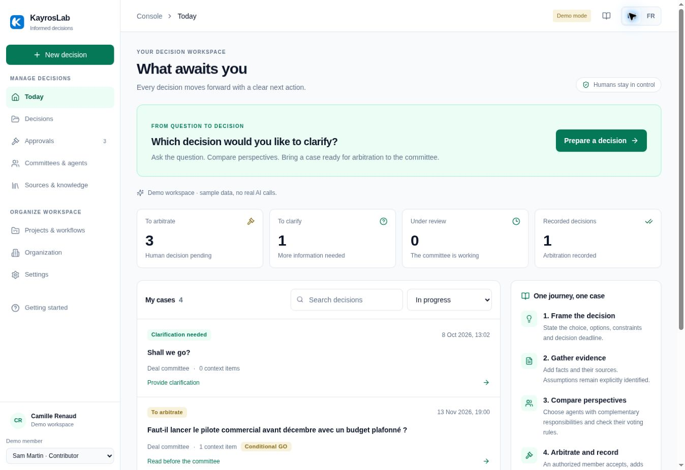
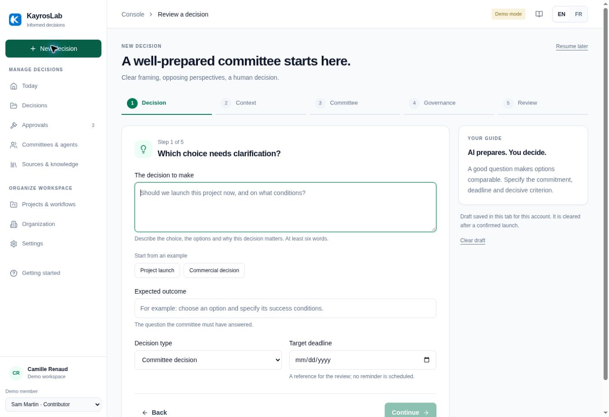
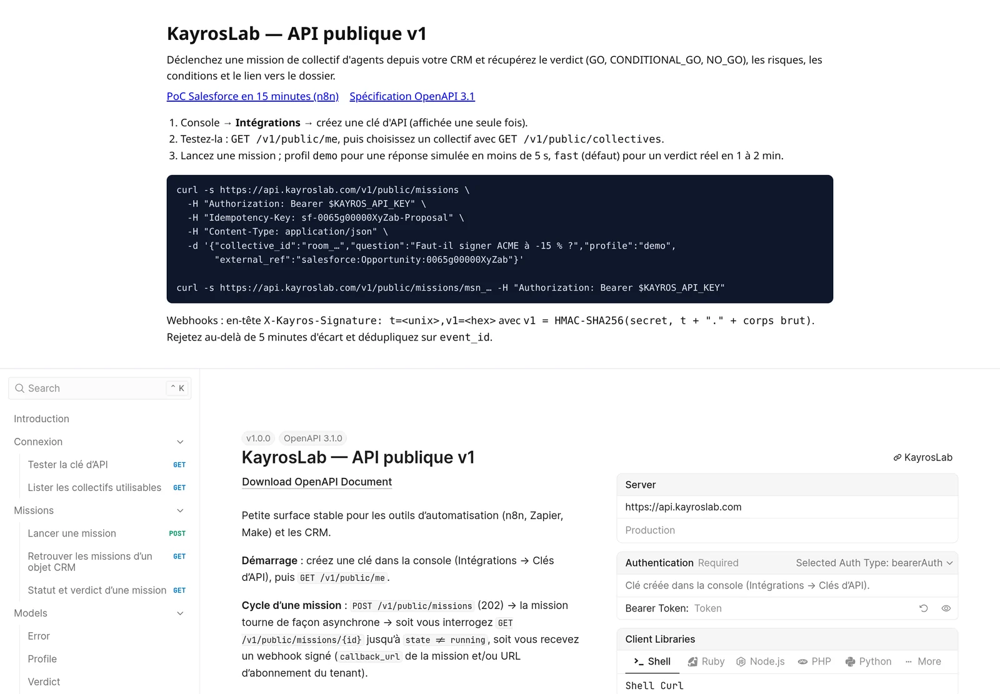

<div align="center">

# KayrosLab

**The governed decision workshop that turns one strategic question into a board-ready verdict.**

You state the decision. A committee of specialized agents with opposing duties investigates the evidence, challenges assumptions, and consolidates objections into a clear verdict — **GO, conditional GO, or NO-GO**. The verdict stays consultative until a human arbitrates. Every claim, source, condition and vote stays in a durable, inspectable dossier.

[](https://www.kayroslab.com)
[](https://www.kayroslab.com/console/)
[](https://api.kayroslab.com/docs)

[Try the console](https://www.kayroslab.com/console/) · [Website](https://www.kayroslab.com) · [API docs](https://api.kayroslab.com/docs) · [Contact](mailto:contact@kayroslab.com)

</div>

<p align="center">
  
</p>
<p align="center"><sub><em>The decision dashboard: what needs attention, what is under review, and the next useful action. Verdicts stay advisory until a human arbitrates. Screenshot uses demonstration data.</em></sub></p>

---

## Why KayrosLab exists

Most strategic decisions are made in a meeting where the strongest voice wins and the numbers are adjusted afterwards. Nobody can reconstruct why the decision was taken — until it is too late.

KayrosLab changes the sequence:

1. **You pose one real decision.**
2. **A collective of agents with opposing duties** (finance, legal, engineering, sales…) investigates the evidence and attacks each other's assumptions.
3. **They return a structured verdict** with objections, conditions and a recommendation.
4. **A human arbitrates** — accepts, attaches conditions, or overrides a veto. Everything is recorded.

The result is not a chatbot answer. It is a **governed dossier** you can reopen, audit and defend.

---

## How it works — the 4-step journey

| Step | What happens | What you get |
|------|--------------|--------------|
| **1. The question** | You state the decision in plain language. | A clear mission scoped to one outcome. |
| **2. The collective** | Specialized agents investigate from their duty, not from a single agreeable model. | Objections, ranges, conditions and a consolidated verdict. |
| **3. The verdict** | GO, conditional GO or NO-GO — always consultative. | An inspectable dossier with sources and justifications. |
| **4. Your arbitration** | You accept, condition or override. A veto can block. | An append-only trail ready for the board or the next steering. |

The same process runs from the web console, Slack, Microsoft Teams or Discord.

---

## Decision-first console

The console opens on **Today**: pending human arbitrations, missing information, active reviews and recorded decisions. Every case has a clear next action, and an AI opinion remains advisory until an authorized member arbitrates.

**Prepare a decision** guides a new user through five steps:

1. **Frame the decision** — the question, expected outcome, decision type and optional target date.
2. **Add context** — facts, assumptions, constraints and actual source text (paste, `.txt` or `.md`).
3. **Choose the committee** — review active AI agents, their responsibilities and veto holders.
4. **Check governance** — inspect the saved voting rule and human permissions before acknowledging them.
5. **Review and launch** — verify what will be sent, then follow the review in the same case.

<p align="center">
  
</p>

Drafts are kept in the current browser tab, separately for each account and tenant. A failed launch preserves the draft; only a server-confirmed launch clears it. Reader accounts cannot launch, and repeated clicks cannot submit a second request while one is pending. Demo mode is clearly labelled and does not call an AI model.

| Area | Purpose |
| --- | --- |
| **Today** | Prioritized queue, search, status filters and next actions |
| **Decisions** | Complete cases: question, context, opinions, objections, arbitration and history |
| **Approvals** | Direct access to cases waiting for human arbitration |
| **Committees & agents** | Reusable AI committees, agent responsibilities, models and voting rules |
| **Sources & knowledge** | Reusable context and versioned skills |
| **Projects & workflows** | Project portfolios, advanced decision graphs and pipeline gates |
| **Organization** | Company structure and project overview |
| **Settings** | Connections, human members, permissions and workspace |
| **Getting started** | A practical explanation of the first decision and workspace setup |

The responsive shell follows the [Nuxt UI dashboard](https://ui.nuxt.com/theme?view=dashboard) visual principles using the existing React/Tailwind stack: slate surfaces, green actions, distinct icons, readable status badges and a mobile navigation menu. The decision journey draws on [Eve](https://github.com/vercel/eve)'s durable context and explicit human-interaction patterns. **The existing KayrosLab AI engine remains in use; this is not an Eve runtime migration.**

English and French use the same flow and controls. User-authored questions and sources are not translated. Existing console hashes and case links remain supported. The detailed eight-stage decision cycle, persona designer, graph editor and channel integrations remain accessible.

Source text is sent to the configured engine only when launched. This flow does not claim to parse PDFs or crawl URLs, and a target date does not schedule a reminder.

See [the full information architecture, user journeys and implementation boundaries](docs/CONSOLE-DECISION-JOURNEY.md).

### How a project runs

- **Parallel branches, joined.** Independent collectives run at the same time, and the next step waits for all of them.
- **Gates stop the flow.** When a gate blocks, the sibling branches still running are suspended and their LLM missions are cancelled, so no tokens are spent for nothing. A COMEX member or an admin lifts the gate with a written justification, and the suspended branches restart.
- **Arbitration branch by branch.** A step can pause for human approval. Each branch waiting for approval gets its own *Approve and continue* button.
- **Temporary composition.** Agent nodes join a collective only for the duration of the mission. The original composition is restored afterwards, even after a server restart or a crash in another process (missions send a heartbeat).
- **Eight-step cycle.** Listen → Map → Build → Position → Test → Arbitrate → Project → Deliver, shown above the graph.

### Roles

| Role | Can |
|------|-----|
| **Admin** | Everything, including members and connections |
| **COMEX** | Arbitrate, lift gates, override a veto |
| **Contributor** | Create projects, run missions, edit the library |
| **Viewer** | Read only. Chat accounts not linked to a member also get this role. |

### English / French

The console ships in **English and French** (EN/FR switch in the header, saved in the browser). User content is never translated.

Every sensitive step can pause for a human. Forecasts are labelled simulations. Secrets stay encrypted. You choose local or cloud per workspace.

---

## The innovation

KayrosLab is the missing layer between conversation and action.

| Approach | What it gives | What is missing |
|----------|---------------|-----------------|
| Chat assistants | Fast answers | No role boundaries, no evidence discipline, no gates, no durable dossier |
| Innovation suites | Idea collection at scale | Weak multi-agent deliberation and human arbitration |
| DIY agent stacks | Orchestration | No memory, console, audit trail or veto by default |

KayrosLab ships the full decision workshop: opposing duties, inspectable reasoning, human gates with veto, and a dossier that survives the meeting.

---

## Trust & control

- **Human gates & veto** — sensitive output pauses for a human. Weighted votes instruct; a veto can block. Append-only trail.
- **Honest numbers** — forecast bands are labelled simulations from stated hypotheses.
- **Tenant isolation** — workspaces, dossiers and memories stay scoped to your organization. Secrets encrypted at rest.
- **Roles enforced server-side** — viewer, contributor, COMEX and admin permissions are checked by the API, not only hidden in the UI. API keys without an owner are refused.
- **Local or cloud** — keep inference on your infrastructure or run a governed cloud. You choose per workspace.

No scraped profiles. No black-box verdicts.

---

## Where it fits

KayrosLab is built for the moment a decision must move from conversation to commitment — with evidence, objections and accountability attached.

Typical uses:
- Launch or pause a project
- Accept or refuse a commercial concession
- Pressure-test a customer RFP against the buying committee
- Prepare a board or steering committee with the objections already surfaced

---

## For technical teams

The public pitch stays buyer-facing. Architects and builders can go deeper:

- Public repository (this one)
- Whitepaper
- Live multi-agent demo
- Public API v1 (`https://api.kayroslab.com/docs`) — launch a mission from your CRM or automation and receive the verdict
- Native Slack, Teams and Discord connectors
- Console API under `/v1/console/*`: companies, projects and their graphs, pipelines (`/projects/:id/pipelines`, `resume`, `approve`, `cancel`), skills, contexts, members and invitations. Details in [`docs/CONSOLE-HYBRID-AGENTS.md`](docs/CONSOLE-HYBRID-AGENTS.md)
- Durable async runs with cancellation (`AbortSignal` propagated down to the LLM call) and multi-process-safe recovery

<p align="center">
  
</p>
<p align="center"><sub><em>Public API v1 documentation at api.kayroslab.com/docs: quick start, signed webhooks and the OpenAPI 3.1 reference.</em></sub></p>

See the existing detailed technical sections further down in this README for API, connectors and architecture.

---

## Get started

1. Open the [console](https://www.kayroslab.com/console/).
2. Choose **Prepare a decision** and complete the five guided steps.
3. Follow the committee’s review and supply any missing context.
4. Have an authorized human arbitrate the recommendation.

Or [book a conversation](mailto:contact@kayroslab.com).

### Self-host (Docker)

```bash
cp deploy/docker/.env.example .env   # set POSTGRES_PASSWORD and KAYROS_AUTH_SECRET
docker compose up --build            # console: http://localhost:8080/console/
```

The stack runs `fastify` (API), `postgres` and `console` (nginx, proxies `/v1`). The decision harness runs with `KAYROS_HARNESS_MODE=enforce`, and `personas/` is mounted read-only.

---

*KayrosLab — crash-test your strategic decisions before the real world does.*
